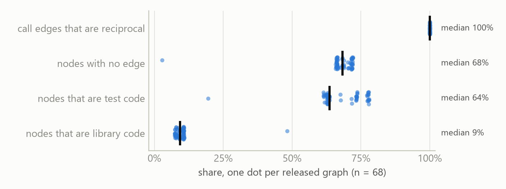
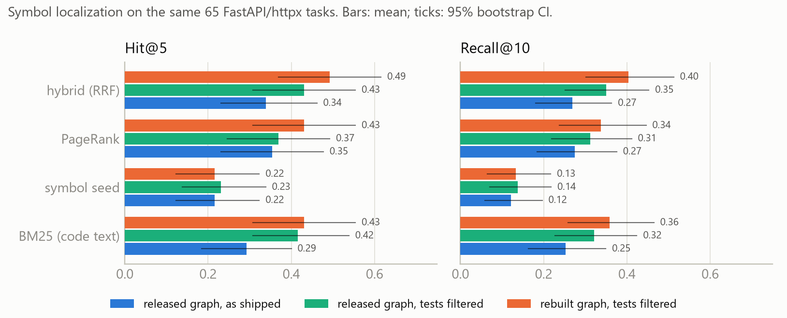
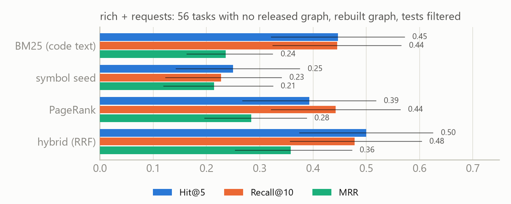

# SWE-GraphBench: Auditing and Rebuilding Code Graphs for Local Software-Engineering Agents

## A dependency-free graph builder, corrected graphs for every public task, and a symbol-level localization benchmark for the Gemma 4 Developer Agent release

**Nathaniel Shingleton** (independent researcher), nate.me.ton@gmail.com

## Abstract

Local coding agents built on Gemma 4 navigate repositories through a 32k-token window and a bounded tool budget, so the code-intelligence tools the competition harness exposes are the only repository-level navigation an agent has. We audit the graphs and embeddings behind those tools and find them structurally weaker than their interface suggests: graphs exist for only 68 of the 129 public tasks; in every graph 100% of `calls` edges are reciprocal, so caller/callee direction is lost; a median 68% of nodes have no edge; a median 9% of nodes are library code against 64% test code; 99.7% of `async def` definitions are missing and nested functions are hoisted into colliding identifiers; and no node carries a file path or line number. We release SWE-GraphBench: (1) the audit as reproducible scripts, (2) a ~300-line pure-standard-library graph builder that emits the competition schema with directed call edges, async and nested definitions, location attributes and `contains`/`imports`/`inherits` edges, fast enough to run inside the air-gapped sandbox, (3) corrected graphs for all 127 task commits, including the 59 rich and requests commits that have no released graph, and (4) a benchmark of 121 tasks with patch-derived gold symbols and LLM-free localization baselines reported as Recall@k, Hit@k and MRR with paired bootstrap statistics and an explicit coverage ceiling. On the 65 tasks where both graphs exist, moving from the graph as shipped to the rebuilt graph with test nodes filtered raises the best retriever's Hit@5 from 0.34 to 0.49 and Recall@10 from 0.27 to 0.40, and the rebuilt graphs make graph-based localization possible on the 56 tasks that previously had none. Code, graphs and results are released under Apache-2.0.

## 1. Introduction

The Gemma 4 Developer Agent competition asks for an agent that fixes real GitHub issues offline on a single accelerator, with a 32,768-token context, a per-task tool-call budget and a 4 GiB sandbox. Under these constraints the first and most expensive sub-problem is *localization*: finding the few functions an issue is about before the context fills with irrelevant file reads. Agentless and graph-guided agents such as LocAgent report that most end-to-end failures on SWE-bench are localization failures and that a code graph is the most effective structure for narrowing a repository to a few candidates.

The organizers released such a structure: per task commit, a NetworkX node-link JSON graph of symbols with `calls` edges and a 256-dimensional embedding per symbol, exposed through three sandboxed tools. The artifacts themselves have not been examined, and because the hidden test set uses private repositories, an agent cannot bring a precomputed graph: whatever graph exists at evaluation time is the organizers' or one the agent builds inside the sandbox.

This paper treats the released artifacts as an object of study and then fixes what the audit finds. Our contributions are:

- **An audit** (Section 3) of all 68 released graphs and 127 embedding archives, every statistic produced by a script: availability, edge direction, isolation, composition, missing `async` and nested definitions, hoisting collisions, embedding duplication, and coverage of the symbols reference patches edit.
- **A builder** (Section 4.2) that emits the same JSON schema from source with nothing but Python's `ast` module: every definition including `async` and nested ones, directed call edges annotated with their resolution rule, containment, import and inheritance edges, and file and line attributes. It runs in about 20 s on FastAPI, so an agent can run it as a skill script on an unseen repository.
- **Corrected graphs** for all 127 (repository, commit) pairs, released as a Kaggle dataset, including the 59 rich and requests commits for which no graph exists and the harness therefore exposes no code-intelligence tools.
- **A benchmark** (Section 4) of 121 tasks with patch-derived gold symbols and a protocol that reports the coverage ceiling next to every retrieval number, so "the graph cannot represent the answer" is never confused with "the retriever missed it".
- **Findings** (Section 5) on released versus rebuilt graphs under identical methods, and on what test filtering, edge direction and the released embeddings each contribute.

Everything is deterministic and runs on a laptop CPU with no language model in the loop: the question is what the *graph* supports, and an LLM would confound graph quality with prompt quality.

## 2. Related work

**Task source.** SWE-bench (Jimenez et al., 2024) and its Lite and Verified subsets define the issue-to-patch task we inherit; SWE-Gym (Pan et al., 2025) and SWE-smith (Yang et al., 2025) scale training data for it. We change the label from "tests pass" to "the symbols the reference patch edits", scoring retrieval rather than resolution.

**Localization as a sub-problem.** Agentless (Xia et al., 2024) measures how often hierarchical localization contains the ground-truth file and elements; LocAgent (Chen et al., 2025) introduces Loc-Bench with function-level Acc@k over a self-built code graph; SweRank (Reddy et al., 2026) shows trained retrieve-and-rerank can match agents; CoSIL (Jiang et al., 2025), OrcaLoca (Yu et al., 2025), KGCompass (Yang et al., 2025), GraphLocator (Liu et al., 2026) and RepoNavigator (Zhang et al., 2025) localize over graphs they construct, and ARISE (Seddik et al., 2026) packages such a graph as an agent toolset. GREPO (Wang et al., 2026) is the closest academic benchmark: class- and function-level localization over repository graphs with Hit@K, built from 86 repositories for GNN training. None study an *externally supplied, fixed* graph or report its coverage ceiling, which is the situation a competition agent faces. RepoGraph (Ouyang et al., 2025), CodexGraph (Liu et al., 2025), CodeRAG (Li et al., 2025), GraphCoder (Liu et al., 2024), RepoCoder (Zhang et al., 2023) and CodePlan (Bairi et al., 2023) use dependency structure for generation; our PageRank baseline is their LLM-free analogue.

**Concurrent competition entries.** Two public paper-track repositories independently compare BM25, embedding and one-hop graph retrieval on the released artifacts with patch-derived gold (aghasalim, 2026; satiricalguru, 2026); both note that `search_similar_code` only accepts symbol names. Our audit confirms and extends their observations (edge direction, hoisting collisions, missing async definitions, no location attributes, absent graphs for two repositories); what we add is the corrected resource: a sandbox-runnable builder, graphs for every task, a frozen gold set with paired statistics, and a released-versus-rebuilt comparison under identical conditions.

## 3. The released artifacts: an audit

*Setup.* The public release contains `tasks.jsonl` (129 tasks: 67 `fastapi/fastapi`, 48 `Textualize/rich`, 13 `psf/requests`, 1 `encode/httpx`), 68 graph files and 127 embedding files keyed by `<repo>_<sha>`. We cloned the four repositories and verified that every base commit resolves; all numbers come from scripts 02 and 06 in the repository.

**Availability.** Graphs exist for the 67 FastAPI commits and the single httpx commit only. The 61 rich and requests tasks have embeddings but no graph, and because the harness enables the tools only when both files exist, agents on those tasks receive no code-intelligence tool.

**Structure (Figure 1).** Every graph has a single edge type, `calls`. In all 68 graphs, 100% of edge pairs are reciprocal: for every `A calls B` there is a `B calls A`, so `get_code_neighbors` cannot distinguish callers from callees. A median 68% of nodes are isolated (3% for httpx to 72%), a median 64% are test functions and only 9% belong to the library package. The highest-degree node in every FastAPI graph is the `FastAPI` class (degree 123), suggesting calls resolved by name matching rather than scope.

*Figure 1. Four structural measures of the 68 released graphs, one dot per graph.*

**Node attributes and identifiers.** Nodes carry only `id`, `name` and `text`: no file path, line number, kind or parent, so an agent that finds a symbol still needs a grep to open it. Comparing node sets against an `ast` walk of the same commit (Section 4.2) shows three systematic omissions: (i) `async def` is not a node: 69,845 of 70,070 async definitions across the 68 commits (99.7%) are absent, including FastAPI's `solve_dependencies`, `serialize_response` and the request-handler closure `app`; (ii) nested synchronous functions are hoisted to their enclosing class or module (8,034 released ids), so distinct closures share one identifier (`fastapi.applications.FastAPI.decorator` stands for two different inner functions) and 2,095 released ids are ambiguous; (iii) 2,289 released ids (0.9%) have no counterpart at all. Overall 25.0% of the 341,563 definitions present at those commits have no released node.

**Embeddings.** Each archive maps symbol name to a 256-d `float32` vector; keys match the node ids exactly. Vectors are unnormalized and deterministic in the node text: 14.6% of rows in a FastAPI archive are exact duplicates, all with identical source. The model is undocumented, and because the sandbox has no encoder, `search_similar_code` must be queried with a symbol name, never with issue text.

**Coverage of what fixes edit.** On the 65 tasks with a graph and at least one gold symbol (Section 4.1), 85.3% of gold symbols exist as nodes and 78.8% also have an edge; 45 of 65 tasks have every gold symbol represented and 4 have none. Missing gold symbols are almost all async or nested definitions.

## 4. SWE-GraphBench

### 4.1 Gold symbols

For every hunk of the reference `patch` in a modified Python file we take the old-file lines it removes (for pure insertions, the preceding context line), read the file at `base_commit`, and record the innermost enclosing `def` or `class` by `ast` line spans including decorators. Symbol ids use the released convention: dotted path from the repository root with a leading `src/` or `docs_src/` dropped, full nesting kept. Added files, non-Python files and module-level edits are kept as separate fields rather than dropped. 121 of 129 tasks have at least one gold symbol (median 1, max 141); 11 add new files; 21 touch module-level code. Gold symbols are necessary, not sufficient, locations, but they are the deterministic proxy used by Agentless, LocAgent and GREPO.

### 4.2 Builder

`swegraphbench/build_graph.py` parses every `.py` file with `ast` and emits a node per module, class, function and async function with its full qualified name, `kind`, `file`, `lineno`, `end_lineno`, `is_async`, `parent`, first docstring line and source text. Edges are `contains`, `imports` (relative imports resolved), `inherits` and directed `calls`. Call targets are resolved in a fixed order and each edge records the rule that fired: `self` (through the class and its resolved bases), `scope` (module definitions and import bindings, including class instantiation), `enclosing` (nested function calling an outer-scope sibling), `suffix2` (`obj.method` unique in the repository) and `suffix1` (bare name unique in the repository). Unresolvable calls, mostly to the standard library and third-party packages, are counted but never guessed, so consumers can filter edges by confidence. The harness tools load the file unchanged.

The builder has no dependency outside the standard library, is about 300 lines, and processes a FastAPI commit (1,120 files, 6,400 nodes) in roughly 20 s on one laptop core. A unit test on a synthetic package checks every resolution rule and that no reciprocal pair is produced. As a validation against the released graphs, 53,793 of the 81,967 released undirected call pairs (65.6%) are also found by the resolver in at least one direction; the remaining third are pairs that scope-based resolution does not reproduce. The resolver emits 142,657 directed call edges over the same 68 commits, of which at most 1.4% per graph are reciprocal.

### 4.3 Baselines and metrics

All baselines take the problem statement and the graph (plus embeddings when available) and return a ranked list of node ids:

- **BM25 (name / text)** over identifier-split tokens of the dotted name or of the source text.
- **Symbol seed**: identifiers mentioned in the issue (back-ticked spans, dotted paths, snake_case and CamelCase tokens) resolved to nodes with the harness's four-tier rule (exact, suffix, case-insensitive, substring), ranked by weighted mention count: the strongest query the released `search_similar_code` can express.
- **Embedding expansion**: the mean released vector of the top seeds, expanded by cosine similarity.
- **Personalized PageRank** from the top-10 BM25 seeds over `calls` edges, undirected or directed.
- **Hybrid**: reciprocal-rank fusion of BM25-text, embedding expansion and PageRank.

Each condition may drop test nodes from the candidate set, a filter any library-fixing agent can apply for free. We report Recall@k and Hit@k for k in {1, 5, 10, 20} and MRR, averaged over tasks with 95% bootstrap confidence intervals (2,000 resamples), always alongside the coverage ceiling: the Recall a perfect ranking could reach given which gold symbols are nodes.

## 5. Experiments

### 5.1 Released versus rebuilt graphs

Conditions use the 65 FastAPI and httpx tasks with both a released graph and a gold symbol (Section 5.2 excepted). Table 1 gives means, Figure 2 confidence intervals, and `results/paired_stats.json` paired bootstrap intervals and sign tests for every contrast.

**Table 1.** Hit@5 / Recall@10 / MRR on the same 65 tasks; "Cov." is the coverage ceiling.

| Graph | Tests | Cov. | BM25 text | Symbol seed | Embedding | PageRank | Hybrid |
|---|---|---|---|---|---|---|---|
| released | kept | 0.854 | .292 / .253 / .189 | .215 / .122 / .172 | .215 / .141 / .179 | .354 / .275 / .167 | .338 / .269 / .238 |
| released | filtered | 0.854 | .415 / .321 / .280 | .231 / .137 / .182 | .231 / .152 / .190 | .369 / .312 / .201 | .431 / .350 / .295 |
| rebuilt | filtered | 1.000 | .431 / .358 / .264 | .215 / .133 / .182 | n/a | .431 / .337 / .266 | **.492 / .403 / .299** |
| rebuilt, PPR to callees | filtered | 1.000 | .431 / .358 / .264 | .215 / .133 / .182 | n/a | .369 / .341 / .249 | .446 / .394 / .314 |
| rebuilt, PPR to callers | filtered | 1.000 | .431 / .358 / .264 | .215 / .133 / .182 | n/a | .338 / .345 / .261 | .385 / .374 / .292 |
| rebuilt + released emb. | filtered | 1.000 | .431 / .358 / .264 | .215 / .133 / .182 | .200 / .122 / .179 | .431 / .337 / .266 | .477 / .403 / .294 |

*Figure 2. Hit@5 and Recall@10 on the same 65 tasks; ticks are 95% bootstrap intervals.*

**Filtering tests is the single largest cheap win.** Removing test nodes from the candidate set raises BM25 Hit@5 on the released graph from 0.292 to 0.415 (paired 95% CI +0.03 to +0.22, sign test p = 0.02) and Recall@10 from 0.253 to 0.321 (p = 0.006). An agent fixing library code can apply this filter for free; the released graph's 64% test share makes it necessary.

**The rebuilt graph helps on top of that, modestly.** With tests filtered in both, the rebuilt graph lifts the hybrid retriever from 0.431 to 0.492 Hit@5 and 0.350 to 0.403 Recall@10 (paired CI −0.01 to +0.12, 15 wins / 5 losses, p = 0.04) and PageRank MRR from 0.201 to 0.266. At 65 tasks not every metric's gain is individually significant. They come from two sources the audit predicted: the coverage ceiling rises from 0.854 to 1.0 because async and nested gold symbols now exist, and scope-resolved call edges give PageRank a cleaner neighbourhood. End to end, from the graph as shipped to the rebuilt filtered graph, the hybrid retriever gains +0.154 Hit@5 (CI +0.05 to +0.26, p = 0.02) and +0.134 Recall@10 (CI +0.07 to +0.21, p < 0.001).

**Edge direction does not help seed expansion.** Propagating from BM25 seeds toward callees only is worse than undirected propagation (PageRank Hit@5 0.369 vs 0.431), and toward callers only is worse still (0.338). Gold symbols are as often callers of a mentioned symbol as callees, so for expansion direction is best kept available but not enforced; it remains essential for tool semantics, since `get_code_neighbors` can finally answer "who calls this".

**The released embeddings add nothing measurable.** Because its query must itself be a resolved symbol, embedding expansion returns nothing on the 26 of 65 tasks whose issue names no resolvable symbol, has the same top-5 as symbol seeding on 45 tasks, and where it differs gains only +0.015 Recall@10. Adding the released vectors to the rebuilt graph leaves every metric unchanged or marginally lower.

### 5.2 Tasks the release left uncovered (56 rich and requests tasks)

On the 56 rich and requests tasks with gold symbols and no released graph, the rebuilt graph with tests filtered reaches Hit@5 0.500, Recall@10 0.478 and MRR 0.358 with the hybrid retriever (Figure 3), on par with the FastAPI tasks; over all 121 tasks the same configuration scores 0.496 / 0.438 / 0.326. Under the released artifacts an agent on these tasks has no graph tool at all.

*Figure 3. Localization on the 56 rich and requests tasks using only the rebuilt graph.*

## 6. Limitations

Static resolution misses dynamic dispatch, rebinding decorators and calls through container attributes; the resolver reports these as unresolved rather than guessing, trading call-edge recall for interpretable precision. Gold symbols come from one reference patch; equally valid fixes can live elsewhere. The benchmark covers four Python repositories and 121 public tasks, and public-task results do not predict hidden-task results. We do not report an end-to-end resolution rate; the leaderboard measures that, and our claim is about the graph layer beneath it. Embeddings for the rebuilt nodes from a documented open model are future work.

## 7. Conclusion

The code graph an agent is handed is not neutral infrastructure. For the Gemma 4 Developer Agent release it is undirected, mostly tests, missing every async function, and absent for half the tasks. A builder small enough to run inside the sandbox removes all four defects, and SWE-GraphBench measures what that buys with no language model in the loop: a drop-in improvement for competition agents and a reusable protocol for auditing any precomputed code graph before building on it.

## References

- aghasalim (2026). gemma4-code-graph-localization. GitHub. https://github.com/aghasalim/gemma4-code-graph-localization
- Bairi, R. et al. (2023). CodePlan: Repository-level coding using LLMs and planning. arXiv:2309.12499.
- Chen, Z. et al. (2025). LocAgent: Graph-guided LLM agents for code localization. ACL 2025. arXiv:2503.09089.
- Gemma Team (2026). Gemma 4 technical report. arXiv:2607.02770.
- Google (2026). The Gemma 4 Developer Agent Competition and Paper Track. Kaggle. https://www.kaggle.com/competitions/gemma-4-developer-agent
- Jiang, Z. et al. (2025). CoSIL: Software issue localization via LLM-driven code repository graph searching. arXiv:2503.22424.
- Jimenez, C. E. et al. (2024). SWE-bench: Can language models resolve real-world GitHub issues? ICLR 2024. arXiv:2310.06770.
- Li, J. et al. (2025). CodeRAG: Supportive code retrieval on bigraph for real-world code generation. arXiv:2504.10046.
- Liu, W. et al. (2024). GraphCoder: Enhancing repository-level code completion via code context graph-based retrieval. arXiv:2406.07003.
- Liu, W. et al. (2026). GraphLocator: Graph-guided causal reasoning for issue localization. FSE 2026. arXiv:2512.22469.
- Liu, X. et al. (2025). CodexGraph: Bridging large language models and code repositories via code graph databases. NAACL 2025. arXiv:2408.03910.
- Ouyang, S. et al. (2025). RepoGraph: Enhancing AI software engineering with repository-level code graph. ICLR 2025. arXiv:2410.14684.
- Pan, J. et al. (2025). Training software engineering agents and verifiers with SWE-Gym. ICML 2025. arXiv:2412.21139.
- Reddy, R. G. et al. (2026). SweRank: Software issue localization with code ranking. ICLR 2026. arXiv:2505.07849.
- satiricalguru (2026). Gemma-graph-nav. GitHub. https://github.com/satiricalguru/Gemma-graph-nav
- Seddik, S. et al. (2026). ARISE: A repository-level graph representation and toolset for agentic program repair and fault localization. arXiv:2605.03117.
- Wang, J. et al. (2026). GREPO: A benchmark for graph neural networks on repository-level bug localization. arXiv:2602.13921.
- Xia, C. S. et al. (2024). Agentless: Demystifying LLM-based software engineering agents. arXiv:2407.01489.
- Yang, B. et al. (2025). Enhancing repository-level software repair via repository-aware knowledge graphs (KGCompass). arXiv:2503.21710.
- Yang, J. et al. (2025). SWE-smith: Scaling data for software engineering agents. NeurIPS 2025. arXiv:2504.21798.
- Yu, Z. et al. (2025). OrcaLoca: An LLM agent framework for software issue localization. ICML 2025. arXiv:2502.00350.
- Zhang, F. et al. (2023). RepoCoder: Repository-level code completion through iterative retrieval and generation. EMNLP 2023. arXiv:2303.12570.
- Zhang, Z. et al. (2025). One tool is enough: Reinforcement learning for repository-level LLM agents (RepoNavigator). arXiv:2512.20957.
